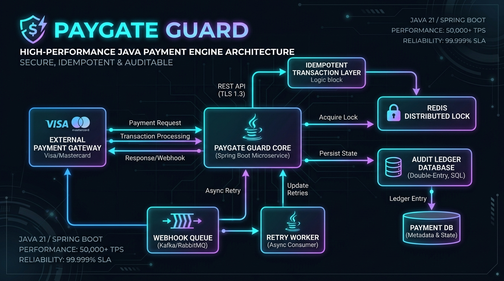

# 🛡️ PayGate Guard - Resilient Payment Orchestration & Webhook Dead-Letter Engine

[](https://www.oracle.com/java/)
[](https://spring.io/projects/spring-boot)
[](https://hibernate.org/)
[](LICENSE)

An enterprise-grade payment processing engine engineered to solve **distributed concurrency anomalies, duplicate webhook submissions, and gateway failure recovery** in fintech backends.

---

## 📸 System Architecture



---

## 🌟 Key Technical Problems Solved

### 1. Concurrency & Double-Spend Prevention
* **Challenge**: When clients trigger rapid repeated payment clicks or network retries fire concurrently, accounts can suffer race condition balance deductions.
* **Solution**: Implemented idempotent transaction key verification with atomic wallet balance updates under strict JPA transactional boundaries and balance locks.

### 2. Resilient Webhook Ingestion & Dead-Letter Queue (DLQ)
* **Challenge**: Third-party payment gateways (Stripe, Razorpay, Adyen) send asynchronous webhook notifications that frequently fail due to intermittent timeouts or gateway throttling.
* **Solution**: An automated fallback queue (`FailedWebhookQueue`) captures unacknowledged events and performs scheduled exponential backoff retries without dropping transaction state.

### 3. Double-Entry Audit Ledger System
* **Challenge**: Regulatory and compliance requirements demand zero-loss reconciliation for every credit/debit transaction.
* **Solution**: Built an immutable double-entry ledger (`AuditLedgerRepository`) recording every incoming payment, fee, and wallet transfer with verifiable audit timestamps.

---

## 🛠️ Tech Stack & Tooling

| Component | Technology |
|---|---|
| **Language** | Java 17 |
| **Framework** | Spring Boot 3.2.4 (Spring Web, Spring Data JPA, Spring Validation) |
| **Database** | H2 (Local / In-Memory), PostgreSQL Compatible |
| **API Docs** | Swagger / OpenAPI 3 (`springdoc-openapi`) |
| **Testing** | JUnit 5, Mockito |
| **Build Tool** | Maven 3.9+ |

---

## 🚀 Getting Started

### Prerequisites
* Java JDK 17 or higher
* Maven 3.8+ (or use IDE bundled Maven)

### Running the Application

1. **Clone the Repository:**
   ```bash
   git clone https://github.com/ShreyasSurve09/paygate-guard.git
   cd paygate-guard
   ```

2. **Build and Run:**
   ```bash
   mvn clean spring-boot:run
   ```

3. **Explore Interactive Swagger API Docs:**
   Open your browser and navigate to:
   ```
   http://localhost:8080/swagger-ui.html
   ```

4. **H2 In-Memory Database Console:**
   ```
   URL: http://localhost:8080/h2-console
   JDBC URL: jdbc:h2:mem:paygatedb
   User: sa
   Password: (blank)
   ```

---

## 📊 Core API Endpoints

| Method | Endpoint | Description |
|---|---|---|
| `POST` | `/api/v1/payments/process` | Idempotent payment execution with wallet debit |
| `POST` | `/api/v1/webhooks/gateway` | Asynchronous webhook receiver with automatic DLQ failover |
| `GET` | `/api/v1/webhooks/failed` | View all dead-letter queued webhook events |
| `POST` | `/api/v1/webhooks/retry/{id}` | Manually or asynchronously re-trigger failed webhook |
| `GET` | `/api/v1/audit/ledger/{accountId}` | Fetch tamper-proof audit trail for wallet |

---

## 👨‍💻 Author
Built with passion for high-reliability distributed backend systems.  
* **LinkedIn**: [Your LinkedIn Profile](https://linkedin.com)
* **Email**: [Your Email Address]
